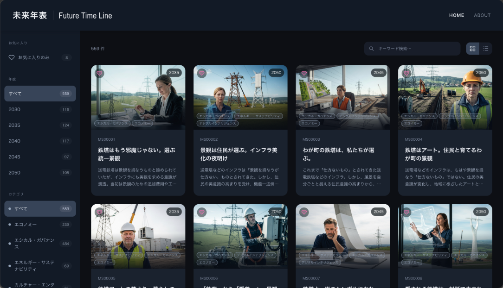

# 未来年表 | Future Time Line

**2030〜2050年の社会や暮らしを、画像付きの未来シナリオから探索するSharePointアプリです。**

年度・カテゴリ・キーワードで気になる未来を探し、詳細画面で「これまで／これから」の変化や生活者の視点を読めます。お気に入りはユーザーごとにSharePointへ保存し、別の端末でも続きを閲覧できます。

## 画面イメージ

### HOME：未来シナリオを探す



左のサイドバーで条件を選び、一覧上部でキーワード検索やカード／リスト表示の切り替えができます。カードを選ぶとシナリオの詳細を表示します。

## 主な機能

| 機能 | できること |
|---|---|
| HOME | 559件の未来シナリオを画像付きカード／リストで閲覧 |
| 絞り込み・検索 | 年度、カテゴリ、キーワード、お気に入りを組み合わせて検索 |
| シナリオ詳細 | 概要、変化の前後、背景、未来シナリオ本文、参照情報を表示 |
| 生活者の視点 | 関連する生活者シナリオを展開して閲覧（全3,304件） |
| お気に入り | 自分専用の一覧をSharePointに保存。保存状況の通知・失敗時の再試行に対応 |
| ABOUT | アプリの紹介ページ（現在は仮の紹介文） |
| スマホ対応 | 画面幅に合わせたレイアウトとハンバーガーメニュー |

対象年度は **2030・2035・2040・2045・2050年**です。チームへの共有機能は未実装です。

## 使い方

1. **HOMEで探す**：サイドバーの年度・カテゴリや、一覧上部のキーワード検索で絞り込みます。
2. **表示を切り替える**：カード／リストを選択します。最初は40件を表示し、「さらに表示」で40件ずつ追加できます。
3. **詳細を読む**：シナリオをクリックすると詳細モーダルが開きます。「生活者の視点」は項目を展開して読めます。
4. **お気に入りに保存する**：ハートを押して登録・解除します。サイドバーの「お気に入りのみ」で登録済みのシナリオを表示できます。
5. **紹介を見る**：ヘッダーのABOUTへ切り替えます。HOMEへ戻っても検索・絞り込み・表示件数は維持されます。

キーワードはID、タイトル、概要、カテゴリ、背景、詳細文章を検索します。空白区切りの複数語はAND検索です。サイドバーの件数は全データに対する件数、一覧上部は絞り込み後の件数です。

## 画面と操作の特徴

- 青味を控えたダークテーマ。ヘッダーは固定し、本文をスクロールします。
- 通常時の操作部品は枠線を省き、背景色で区別します。キーボード操作時のフォーカス表示は維持しています。
- シナリオは35msずつ遅らせて450msでフェードインし、詳細は103%から100%へ縮小しながら800msで表示します。OSの `prefers-reduced-motion` 設定では動きを抑制します。
- 読み込み通知はフローティング表示で、通知の消失によってカードの位置は変わりません。画像は遅延読み込み、生活者データは詳細表示時に読み込みます。
- お気に入りの保存状況は右下のトーストで表示します。完了通知は3秒で消え、失敗通知には再試行ボタンを表示します。

## 技術構成

| 項目 | 使用技術 |
|---|---|
| アプリ基盤 | SharePoint Framework（SPFx）1.23.2 |
| UI | React 17、TypeScript、Fluent UI 8、SCSS Modules |
| 開発・ビルド | Node.js 22（22.14以上・23未満）、npm、Heft |
| シナリオデータ | Excelから生成した静的JSONと画像 |
| お気に入り保存 | SharePointリスト／REST API（利用者本人の権限） |

Webパーツ名は **FTLApp**、配置先のページ名は **FTLApp.aspx** です。

## 開発サーバー

```bash
npm install
npm run start
```

`npm run start` は Heft の開発サーバーを起動し、[config/serve.json](./config/serve.json) に設定した SharePoint ページを開きます。起動先の `FTLApp.aspx` が SharePoint サイトに存在し、アクセス可能であることを確認してください。初回は開発用 HTTPS 証明書の信頼を求められる場合があります。

開発ポートは `4321` です。SPFx 1.23.2 のデバッグ manifest 生成処理がこのポートを既定の読込先として追加するため、参照アプリなど同じポートを使う開発サーバーは停止してから起動してください。

### ページへの初回配置

`npm run start` はページや Web パーツの配置を自動作成しません。デバッグ用 URL はローカルの Web パーツを読み込めるようにする設定です。

1. 開発サーバーを起動し、デバッグパラメーター付きの `FTLApp.aspx` を開きます。デバッグスクリプトの読み込み確認が表示されたら許可します。
2. ページを編集し、セクション内の Web パーツ追加ボタンから `FTLApp` を選択します。
3. ページを保存・公開します。ローカルの変更を見るときはデバッグパラメーター付き URL で開きます。

`FTLApp` が候補に出ない場合は、開発サーバーと HTTPS 証明書の信頼を確認してください。ホスト側でアプリの配置が必要な場合は、ビルドした `sharepoint/solution/sp-fx-ftl-app.sppkg` を管理者がアプリカタログに配置し、必要に応じてサイトへ追加してください。

FTLApp は閲覧モードでブラウザーの表示領域全体を覆い、編集モードでは通常の Web パーツとして表示されます。アプリ専用ページで使用してください。

## お気に入りリストの設定

サイト内に「未来年表お気に入り管理」リストを用意します。

保存先は `/sites/-TMC-/Lists/List2` です。SPFxの利用者本人の権限でREST APIを呼び出し、現在のユーザーの作成者IDで行を検索します。管理者であってもアプリは他人の行を取得しません。

| 列 | 設定 |
|---|---|
| Title | 1行テキスト（表示名を保存） |
| UserKey | 1行テキスト・必須・一意の値：いいえ（ログイン名を保存） |
| FavoritesJson | 複数行テキスト・プレーンテキスト・変更の追加：いいえ |

アイテムレベルの権限は、読み取り・作成／編集とも本人が作成したアイテムに制限してください。アプリによる絞り込みだけではアクセス制限になりません。管理権限を持つユーザーは例外です。一意の値を強制する列と、この権限設定は併用できません。

保存形式は `{"version":1,"scenarioIds":["MS00001","MS00025"]}` です。初回保存で行を作成し、以降はETagを指定して更新します。競合時は最新データにこの画面で追加・削除したIDだけを反映し、最大3回試行します。保存中・未保存エラー時は追加の操作を止め、再試行できるようにします。

一意制約がないため、複数端末で初回作成を同時に行うと重複行ができる場合があります。重複を検出したら自動で削除・上書きせず、管理者による統合が必要なエラーを表示します。厳密な1ユーザー1行の原子的保証はありません。

本人の行がまだない場合、ブラウザーの旧お気に入りを初回保存に含めます。「リストに移行して保存」ボタンでも移行できます。旧データには利用者情報がないため、共有ブラウザーでは自分のデータであることを確認してください。既存のリスト行がある場合はリストを優先し、旧データを再取り込みしません。移行後のマーカーはサイト・ユーザー別に保存し、元の旧データは削除しません。旧データが読めない場合も画面に警告します。

## データ・画像の更新

### Excelデータの更新

Excelと画像フォルダーからローカルの静的データを生成します。元ファイルは変更しません。Python 3の標準ライブラリのみを使います。

```bash
python3 scripts/import-scenarios.py "/path/to/未来シナリオ検証用.xlsx" "/path/to/MS_Dummy"
```

「未来シナリオ」「生活者シナリオ」シートを読み、IDに対応する `MS00001.jpg` 形式の画像をコピーします。Excelの画像列は `_image.png` 形式ですが、今回提供されたJPGのIDで紐付けます。生成先は `src/webparts/ftlApp/data` と `src/webparts/ftlApp/assets/scenarios` です。再取り込み後はビルドしてください。データと画像はSPFxパッケージに含まれ、アプリを読み込める利用者には配信されます。

### 画像だけの差し替え（macOS）

`MS00001_image.png` 形式の画像フォルダーから、シナリオIDに対応する画像だけを差し替えられます。

```bash
python3 scripts/replace-scenario-images.py "/path/to/未来シナリオ画像検証用"
```

macOS標準の `sips` で元の解像度を維持した品質80のJPEGへ変換します。全シナリオの画像が存在し、すべての変換が成功してからアプリ内のJPGを置き換えます。元のPNG、シナリオ本文、お気に入りのIDは変更しません。使用しない追加画像は取り込みません。Excel取り込みを再実行するとその際に指定した画像で上書きされるため、必要に応じて画像差し替えも再実行してください。

## 本番パッケージの生成

```bash
npm run build
```

テストと本番ビルド後、`sharepoint/solution/sp-fx-ftl-app.sppkg` を生成します。開発サーバーとビルドは出力先を共有するため、`npm run start` を停止してから実行してください。

生成したパッケージをSharePointのアプリカタログへ配置し、対象サイトでFTLAppを使用します。シナリオ本文・画像はパッケージに含まれ、アプリを読み込める利用者へ配信されます。
